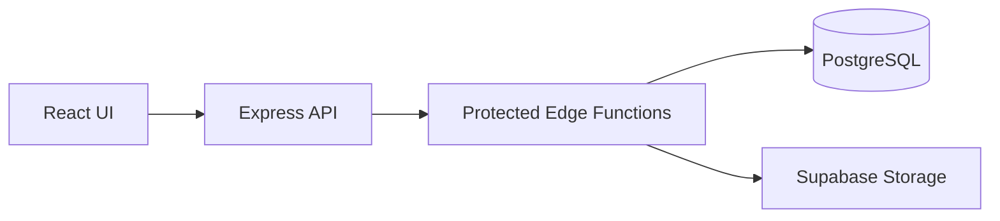

# Multilingual CMS

I built this as a full-stack publishing app, with a public site for readers and a separate editor for managing articles. It supports multiple languages, drafts, image uploads and a basic publishing workflow.

The stack is **React, TypeScript, Vite, Express, PostgreSQL and Supabase**.

## What it does

Readers can browse published articles, archives and tags. The editor has an authenticated studio for writing, translating and publishing content. Articles can include cover images and inline media.

I also added the less visible parts of a publishing site: RSS, sitemap output, canonical metadata and structured data.

## Frontend and backend

The React frontend talks to an Express API. I keep protected data operations behind Supabase Edge Functions, instead of exposing the database tables directly to the browser.



Admin sessions use signed HTTP-only cookies. Database access and media uploads are handled on the server side. The app uses **TanStack Query** for client-side data fetching.

For someone reviewing my full-stack work, the useful parts are the editor workflow, API routes, authentication setup and database integration.

## Local setup

```bash
npm install
cp .env.example .env
npm run dev
```

To run the protected content features, you'll need a Supabase project, the SQL schema in `supabase/SETUP.sql`, the Edge Functions and the environment variables in `.env.example`.

The complete setup and deployment steps are in [DEPLOYMENT.md](DEPLOYMENT.md).

```bash
npm run build
npm start
```

Keep admin credentials, session secrets and backend tokens out of source control.
