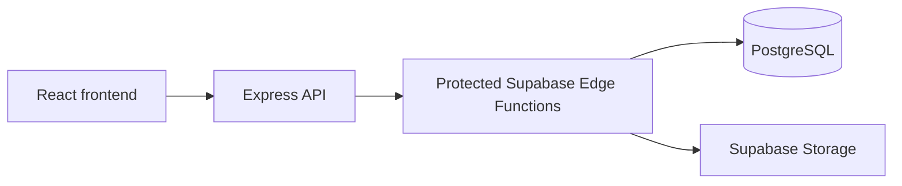

# Multilingual CMS

**A full-stack publishing application built with React, TypeScript, Express, and PostgreSQL.**

This project has two sides: a public site for reading articles and a protected editorial studio for writing, translating, and publishing content. It covers the work behind a complete web product, from responsive UI and backend APIs to authentication, database access, and file uploads.

## What it does

- **Public reading experience:** article pages, archives, tags, and language-specific content.
- **Editorial workflow:** draft, edit, translate, and publish articles through a protected studio.
- **Authentication:** administrator login with signed, HTTP-only session cookies.
- **Media handling:** cover images and inline uploads through Supabase Storage.
- **Content discovery:** RSS, sitemap, canonical metadata, and structured data.
- **Responsive UI:** interfaces for both reading and editing across screen sizes.

## Technology

| Area | Stack |
| --- | --- |
| Frontend | React, TypeScript, Vite, Tailwind CSS |
| Backend | Node.js, Express, protected API routes |
| Data | PostgreSQL, Supabase, Edge Functions |
| Authentication | Passport, signed sessions, HTTP-only cookies |
| Client data | TanStack Query |
| Deployment | Render |

## Architecture



The browser does not connect to the protected content tables directly. The Express backend handles the application's API and session flow, while protected Supabase Edge Functions handle content and media operations. Backend credentials are kept out of the browser.

## What this project demonstrates

- Building and organizing a complete React + Node.js application.
- Connecting interactive interfaces to backend APIs and persistent data.
- Managing authentication and access to protected features.
- Implementing multi-step workflows, including drafts, translations, and publishing.
- Preparing an application for deployment and environment-based configuration.

## Run locally

```bash
npm install
cp .env.example .env
npm run dev
```

To configure a fresh database and protected backend, follow [DEPLOYMENT.md](DEPLOYMENT.md).

## Production

```bash
npm run build
npm start
```

Before deploying, create a Supabase project, apply `supabase/SETUP.sql`, deploy the protected Edge Functions, and set the environment variables from `.env.example`.

**Security note:** keep session secrets, admin credentials, and backend tokens out of Git. Protected Supabase credentials belong in the protected backend environment, not browser configuration.
